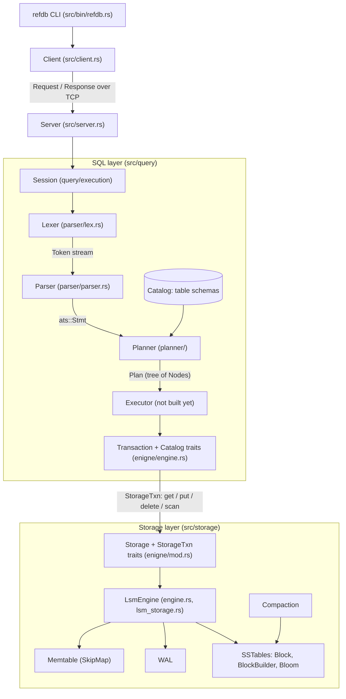

# refDB

An educational SQL database written in Rust, built from first principles:
a **SQL front end** (lexer → parser → planner → executor) on top of an
**LSM-tree key-value storage engine** (memtable, WAL, SSTables, compaction).

> **Status: early development.** The SQL front end is well ahead of the storage
> engine, and the two are not wired together yet. See [Project status](#project-status)
> for an honest per-component breakdown.

## Goals

- Learn how a modern database is structured, end to end
- Keep every layer small, readable and independently testable
- Draw a hard line between layers: SQL knows nothing about files, storage knows nothing about SQL

## Architecture



### How the components interact

A statement such as `SELECT t.a FROM t WHERE t.b = 1` travels through the system like this:

| #   | Stage                                          | Input → Output                                     | Knows about                                                     | Must **not** know about               |
| --- | ---------------------------------------------- | -------------------------------------------------- | --------------------------------------------------------------- | ------------------------------------- |
| 1   | **Lexer** (`parser/lex.rs`)                    | `&str` → `Iterator<Result<Token>>`                 | characters, keywords                                            | grammar                               |
| 2   | **Parser** (`parser/parser.rs`)                | tokens → `ats::Stmt`                               | grammar, operator precedence                                    | table schemas, whether a table exists |
| 3   | **Planner** (`planner/`)                       | `ats::Stmt` + `&impl Catalog` → `Plan`             | schemas (to resolve columns to indexes, check types), constants | storage, how rows are fetched         |
| 4   | **Executor** (to build)                        | `Plan` + `&impl Transaction` → rows / `StmtResult` | plan nodes, row values                                          | keys, bytes, files                    |
| 5   | **Transaction / Catalog** (`enigne/engine.rs`) | typed rows ⇄ key/value pairs                       | row and key encoding, secondary indexes                         | LSM internals                         |
| 6   | **Storage** (`storage/`)                       | `get / put / delete / scan` over `&[u8]`           | memtables, WAL, SSTables                                        | SQL, types, schemas                   |

The contracts between layers are deliberately narrow:

- **Parser → Planner** is `ats::Stmt`, a purely syntactic tree. Column references are still
  names (`Column(Option<table>, name)`) and literals are not type-checked.
- **Planner → Executor** is `Plan` / `Node`. Here names are already resolved to column
  _indexes_ (`types::expression::Expression::Columns(usize)`), and a `SELECT` is a tree such as
  `Projection → Filter → Scan`. `Plan` implements `Display`, which is what `EXPLAIN` will print.
- **Planner ↔ Catalog**: the planner only borrows `&impl Catalog` to look up table schemas
  (`get_table`). It never touches rows.
- **Executor ↔ Transaction**: all reads and writes go through one `Transaction`, which is
  also a `Catalog`. That is what makes `BEGIN` / `COMMIT` / `ROLLBACK` meaningful, because
  DDL and DML share one atomic unit.
- **Transaction ↔ Storage**: the SQL layer encodes rows and keys into bytes and talks to
  storage only through `Storage::begin` → `StorageTxn { get, put, delete, scan, commit, rollback }`.
  Any implementation of those traits can sit underneath, including a plain in-memory
  `BTreeMap` used for tests.
- **Client ↔ Server** exchange `Request` / `Response` values (`server.rs`). The server owns a
  session per connection, and the session owns the current transaction.

### Module map

```text
src/
├── lib.rs                  crate root
├── error.rs                Error (IO / Abort / InvalidData / InvalidInput) and Result<T>
├── bin/refdb.rs            interactive shell (rustyline) + one-shot command mode
├── client.rs               TCP client used by the shell
├── server.rs               wire types: Request, Response
├── query/
│   ├── parser/
│   │   ├── lex.rs          Token, Keyword, Lexer
│   │   ├── parser.rs       recursive-descent + precedence-climbing parser
│   │   └── ats.rs          AST: Stmt, From, Expression, Operator, Literal, Column ...
│   ├── planner/
│   │   ├── planner.rs      Planner::build(Stmt) -> Plan
│   │   ├── plan.rs         Plan, Node (Scan, Filter, Projection, HashJoin, ...), Aggregate
│   │   └── context.rs      name resolution scope: column labels → indexes, aggregates
│   ├── types/
│   │   ├── values.rs       DataType, DefaultValues (runtime values), Row, Label
│   │   ├── schema.rs       Table, Column, validation
│   │   └── expression.rs   resolved Expression + evaluator (three-valued logic)
│   ├── enigne/             Transaction + Catalog (SQL level), Storage + StorageTxn (KV level)
│   └── execution/          session + StmtResult (executor goes here)
└── storage/
    ├── memtable.rs         in-memory sorted map (crossbeam SkipMap)
    ├── wal.rs              write-ahead log
    ├── block.rs            SSTable block: entries + offset table, encode/decode
    ├── block_builder.rs    builds blocks up to a target size
    ├── sst.rs              SSTable file + block metadata
    ├── bloom.rs            bloom filter (empty)
    ├── compact.rs          compaction options
    ├── lsm_storage.rs      LSM state: active + immutable memtables, SSTs
    └── engine.rs           Engine trait + LsmEngine
```

> The directory `query/enigne/` is spelled that way in the source tree, and the docs
> above use the real path.

## SQL dialect

What the **grammar** accepts. Some of this is not usable yet. See
[Known parser issues](#known-parser-issues).

```sql
-- transactions
BEGIN;  COMMIT;  ROLLBACK;
EXPLAIN <statement>;

-- DDL
CREATE TABLE users (
    id    INTEGER PRIMARY KEY,
    name  TEXT NOT NULL,
    email VARCHAR UNIQUE,
    score FLOAT DEFAULT 0,
    org   INT REFERENCE orgs
);
DROP TABLE users;

-- DML
INSERT INTO users (id, name) VALUES (1, 'alice'), (2, 'bob');
UPDATE users SET name = 'carol', score = DEFAULT WHERE users.id = 1;
DELETE FROM users WHERE users.id = 2;

-- queries
SELECT u.id, u.name AS who
FROM users u JOIN orders o ON u.id = o.user_id
WHERE u.score >= 10 AND u.name LIKE 'a%'
GROUP BY u.id
HAVING u.id > 0
ORDER BY u.id DESC
OFFSET 20 LIMIT 10;
```

- **Types**: `BOOL`/`BOOLEAN`, `INT`/`INTEGER`, `FLOAT`/`DOUBLE`, `STRING`/`TEXT`/`VARCHAR`
- **Literals**: integers, floats, `'strings'` (with `''` escape), `TRUE`, `FALSE`, `NULL`, `INFINITY`, `NaN`
- **Operators** (low → high precedence): `OR`, `AND`, `NOT`, `= LIKE IS [NOT] NULL|NaN`,
  `> >= < <=`, `+ -`, `* / %`, unary `- +`
- Keywords and unquoted identifiers are case-insensitive. Identifiers are lower-cased, and
  `"Quoted Identifiers"` keep their case.
- `OFFSET` must come **before** `LIMIT` for now.

## Storage engine

A classic LSM design:

- **Memtable**: recent writes in a lock-free skip list. An empty value is a tombstone.
- **WAL**: appended before the memtable is updated, so writes survive a crash.
- **SSTables**: immutable sorted files made of fixed-size blocks, each block holding
  `[entries][offsets][entry count]`.
- **Bloom filters**: skip SSTables that cannot contain a key.
- **Compaction**: merges SSTables to bound read amplification and reclaim space
  (options: `Simple`, `Tiered`, `Leveled`).

## Project status

| Component                           | State                                                                                                                                         |
| ----------------------------------- | --------------------------------------------------------------------------------------------------------------------------------------------- |
| Lexer                               | ✅ done, tested (`Token`, 55 keywords, strings, quoted identifiers, numbers). Missing `*`, `/`, `%`, `!`, `!=`                                |
| Parser                              | 🟡 works for core statements, with [known bugs](#known-parser-issues). 90 tests (76 passing, 14 `#[ignore]`d known-bug tests)                 |
| AST / types / expression evaluator  | 🟡 mostly done, `checked_pow` and remainder not implemented                                                                                   |
| Planner                             | 🚧 `DROP` done, `CREATE` and `UPDATE` close. `DELETE`, `SELECT` and `INSERT` are stubs. **The crate does not compile until this is finished** |
| Executor / Session                  | ⬜ not started (`StmtResult` only)                                                                                                            |
| Transaction / Catalog (SQL → KV)    | ⬜ traits only                                                                                                                                |
| Memtable                            | ✅ done and tested (`scan` not implemented)                                                                                                   |
| Block / BlockBuilder                | 🟡 encode/decode done. Builder is missing key/value iteration                                                                                 |
| SSTable                             | 🚧 skeleton                                                                                                                                   |
| WAL, Bloom, Compaction, `LsmEngine` | ⬜ stubs                                                                                                                                      |
| Server / Client / CLI               | 🚧 wire types and skeleton, no networking loop or serialization yet                                                                           |

Legend: ✅ done · 🟡 usable with gaps · 🚧 in progress · ⬜ not started

### Known parser issues

These are captured as `#[ignore]`d tests in `src/query/parser/parser.rs`. Run them with
`cargo test --lib parser -- --ignored` and remove the `#[ignore]` as each one is fixed.

| Issue                                                                                                                                                 | Test                                                                                                         |
| ----------------------------------------------------------------------------------------------------------------------------------------------------- | ------------------------------------------------------------------------------------------------------------ |
| `*`, `/`, `%` (and `!`) are not lexed, so `SELECT *`, multiply, divide and remainder are impossible. A trailing unknown character is silently dropped | `select_star`, `multiplicative_operators_bind_tighter_than_additive`, `unknown_character_at_end_is_rejected` |
| A bare identifier (`SELECT id`) is not accepted as a column, only `table.column`                                                                      | `select_unqualified_column`                                                                                  |
| `!=` / `<>` is never produced, although `InfixOp::NotEq` exists                                                                                       | `not_equal_operator`                                                                                         |
| `PRIMARY KEY`: there is no `KEY` keyword                                                                                                              | `create_table_primary_key`                                                                                   |
| Column constraints (`NULL`, `NOT NULL`, `UNIQUE`, `INDEX`, `DEFAULT`, `REFERENCE`) are peeked but never consumed. Some error and some loop forever    | `create_table_column_constraints`                                                                            |
| `UPDATE ... SET` never stores the parsed assignments                                                                                                  | `update_collects_assignments`                                                                                |
| `ORDER BY` requires `ASC`/`DESC` and does not consume it. It should default to ascending                                                              | `select_order_by_with_direction`, `select_order_by_defaults_to_ascending`                                    |
| `INNER JOIN` and `CROSS JOIN` consume their keyword twice. `LEFT` and `RIGHT` joins are missing                                                       | `explicit_inner_and_cross_join`, `left_and_right_join`                                                       |
| `- -1` and `NOT NOT x` fail (`>` should be `>=` in `parse_prefix_op`)                                                                                 | `stacked_prefix_operators`                                                                                   |
| `LIMIT n OFFSET m` (standard order) is rejected                                                                                                       | `select_limit_then_offset`                                                                                   |

## Building and testing

Requires a recent stable Rust toolchain (the crate uses **edition 2024**, so Rust 1.85+).

```bash
cargo build
cargo test                        # unit tests for every module
cargo test --lib parser           # only lexer + parser tests
cargo test --lib parser -- --ignored   # the known-bug tests (expected to fail today)
```

> While the planner is in progress the crate does not compile. To run the parser tests
> in the meantime, temporarily comment out `pub mod planner;` in `src/query/mod.rs`.

## Roadmap

1. **Parser**: fix the issues above (the tests are already written).
2. **Planner**: finish `INSERT`, `UPDATE`, `DELETE`, `SELECT`, with name resolution,
   aggregates and joins. Add `Plan::build`.
3. **In-memory `Storage`**: implement `Storage` / `StorageTxn` over a `BTreeMap`. This lets
   the SQL layer run end to end **without waiting for the LSM engine**.
4. **Transaction / Catalog**: row and key encoding, primary-key lookup, secondary indexes,
   schema persistence.
5. **Executor**: turn each `Node` into a row iterator, then wire up `Session`.
6. **LSM engine**: WAL, `scan`, flush, SST read path, bloom filters, compaction. Swap it in
   behind `StorageTxn`.
7. **Server and shell**: framing and serialization, session management, the CLI.

## License

TBD
